# Secure-Home-Network-Configuration Cisco Packet Tracer

## Project Overview
This project demonstrates the configuration and security of a simulated home network using Cisco Packet Tracer. The network consists of wired and wireless end devices, a wireless router, a cable modem and a coaxial splitter. The project focuses on establishing network connectivity, configuring automatic IP address allocation through DHCP, implementing wireless security controls and verifying network functionality. This project was completed as part of my Cisco Networking Basics training to develop practical skills in IT support, networking and cybersecurity.

## Project Objectives
- Establish wired and wireless connectivity within a simulated home network.
- Configure automatic IPv4 address allocation using DHCP.
- Identify and access the wireless router's management interface using the default gateway.
- Improve router security by changing default administrative credentials.
- Configure a wireless network using a custom SSID.
- Implement WPA2-Personal authentication and encryption.
- Verify network connectivity by testing access to a simulated external web server.
- Document network configurations and provide screenshots as technical evidence.

## Tools and Technologies
- Cisco Packet Tracer
- IPv4 addressing
- Dynamic Host Configuration Protocol (DHCP)
- Wireless Local Area Network (WLAN)
- Ethernet and coaxial cabling
- WPA2-Personal
- Router Graphical User Interface (GUI)

## Technical Skills Demonstrated
- Network topology interpretation
- Wired and wireless network configuration
- Dynamic IP address allocation
- Default gateway identification
- Router administration
- Wireless authentication and encryption
- Basic router hardening
- Network connectivity testing
- Technical documentation

## Network Topology

The network topology illustrates how wired and wireless end devices connect through a central wireless router and cable modem.
The network includes:
- A coaxial splitter
- A cable modem
- A wireless router
- Two wired desktop computers
- A wireless laptop
- A television

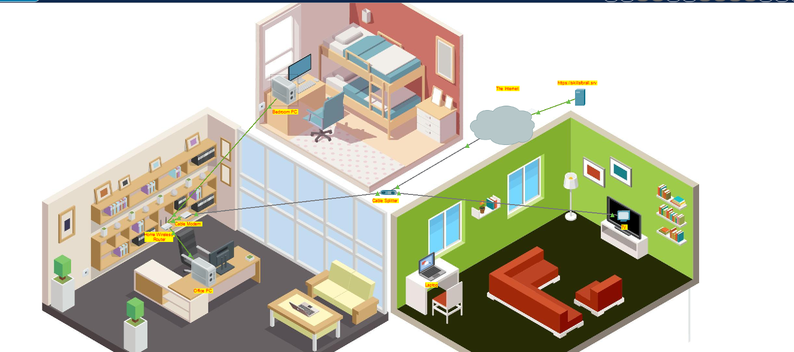

*Figure 1: Completed home network topology in Cisco Packet Tracer.*

## Network Configuration

### Part 1: Physical Network Connections

#### Step 1: Connecting Coaxial Cables

In this simulated home network, internet and television services are delivered through a coaxial cable. A coaxial splitter distributes the incoming cable signal to the cable modem and television.

**Configuration:**

- Connected the cable splitter (Coaxial1) to the cable modem (Port 0).
- Connected the cable splitter (Coaxial2) to the television (Port 0).

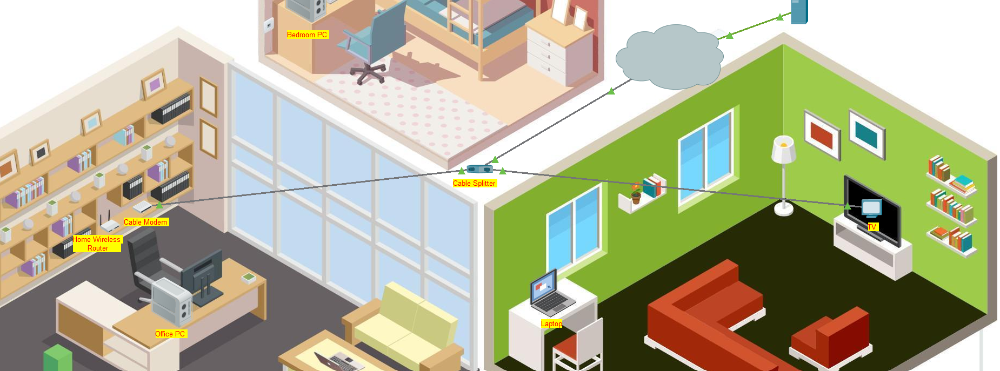

**Purpose:**

The cable modem provides the connection between the home network and the simulated internet service provider (ISP), while the television receives the television signal.

**Verification:**

Powered on the television and confirmed that a television programme was displayed, verifying the simulated television connection.

#### Step 2: Establishing Wired Network Connections

Ethernet cables were used to establish physical connections between the cable modem, wireless router and desktop computers.

**Configuration:**

- Connected the cable modem to the Internet (WAN) port of the wireless router.
- Connected the Office PC to a LAN port on the wireless router.
- Connected the Bedroom PC to a LAN port on the wireless router.

**Purpose:**

The WAN connection enables the wireless router to communicate with the simulated internet service provider through the cable modem.

The LAN connections allow the desktop computers to communicate within the local network and access external network services through the router.

**Evidence:**

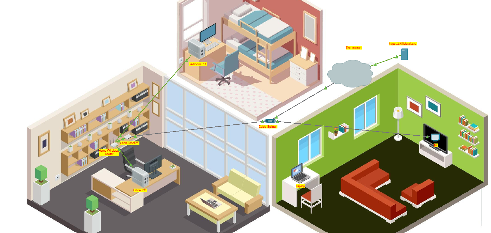
*Physical Ethernet connections between the network devices.*

### Part 2: Wireless Router Configuration

#### Step 1: Configuring IPv4 Addressing and Accessing the Router

The Office PC was configured to obtain its network settings automatically using Dynamic Host Configuration Protocol (DHCP).

**Configuration:**

- Opened the Office PC in Cisco Packet Tracer.
- Navigated to Desktop > IP Configuration.
- Selected DHCP to obtain IPv4 configuration automatically.
- Identified the default gateway address from the assigned network settings.

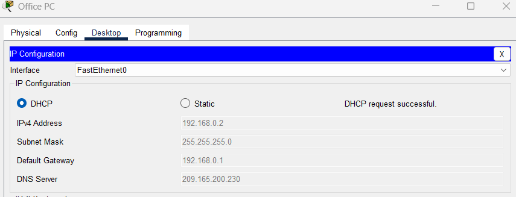

**Purpose:**

DHCP simplifies network administration by automatically assigning network settings, reducing the need for manual configuration and minimising configuration errors.

The default gateway enables devices on the local network to communicate with external networks.

**Accessing the Router:**

- Opened the web browser on the Office PC.
- Entered the default gateway address into the address bar.
- Accessed the wireless router's management interface using the default administrative credentials provided for the simulation.

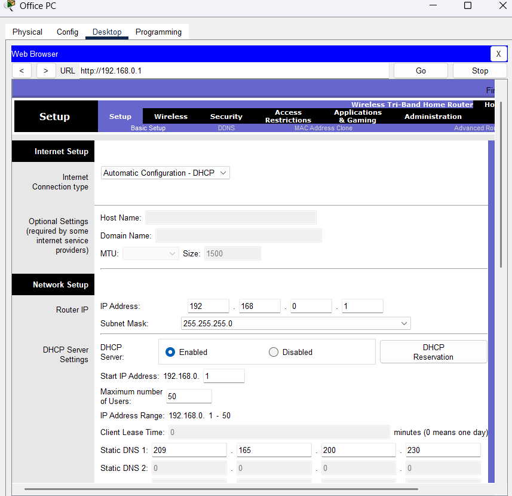

**Verification:**

Successfully obtained IPv4 configuration and accessed the router's management interface.

#### Step 2: Securing Administrative Access and Reviewing DHCP Settings

Default administrative credentials can present a security risk because they may be publicly known and could allow unauthorised access to network infrastructure.

**Configuration:**

- Accessed the wireless router's management interface.
- Reviewed the existing DHCP settings.
- Changed the default administrator password.
- Saved the updated configuration.

**Purpose:**

Changing the default administrator password is a basic router hardening measure that helps protect the management interface against unauthorised access.

Reviewing the DHCP settings helps ensure that connected devices can automatically obtain the network configuration required for communication.

**Evidence:**

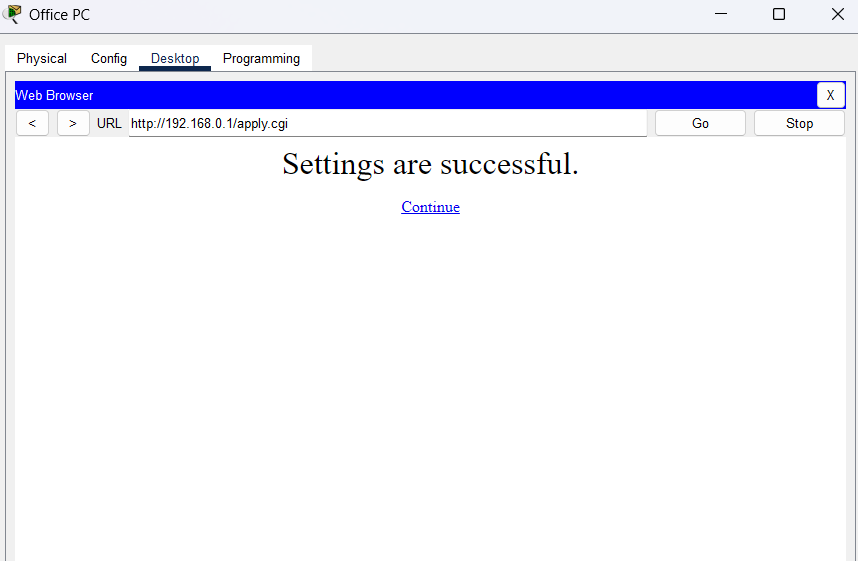

**Security Considerations:**

Unauthorised administrative access could allow an attacker to modify network settings, change wireless security configurations or disrupt network availability.

In a real-world environment, administrative access should be restricted to authorised individuals and protected using strong, unique credentials.

#### Step 3: Configuring the Wireless Network

The wireless router was configured to provide wireless connectivity to compatible end devices within the home network.

**Configuration:**

- Navigated to the wireless settings within the router's management interface.
- Enabled the 2.4 GHz wireless network.
- Configured the Service Set Identifier (SSID) as MyHome.
- Saved the wireless configuration.

**Purpose:**

The SSID identifies the wireless network and allows users to distinguish it from other available wireless networks.

The 2.4 GHz frequency band provides wireless connectivity and generally offers greater coverage than higher frequency bands, although it can be more susceptible to interference.

**Evidence:**

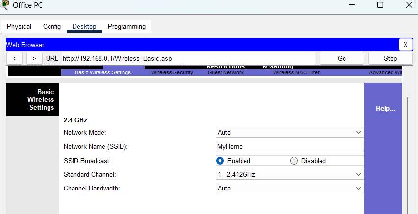

**Security Considerations:**

Configuring a custom SSID helps identify the intended wireless network. However, an SSID alone does not prevent unauthorised access.

Wireless authentication and encryption must be configured separately to protect the network.

#### Step 4: Implementing Wireless Security

Wireless security was configured to protect the home network against unauthorised access and protect data transmitted over the wireless connection.

**Configuration:**

- Navigated to the wireless security settings.
- Selected WPA2-Personal as the wireless security mode.
- Configured a pre-shared key (PSK).
- Saved the wireless security configuration.

**Purpose:**

WPA2-Personal uses a shared passphrase for wireless authentication and provides encryption to protect wireless communications.

Devices must possess the correct passphrase to successfully authenticate to the wireless network.

**Evidence:**

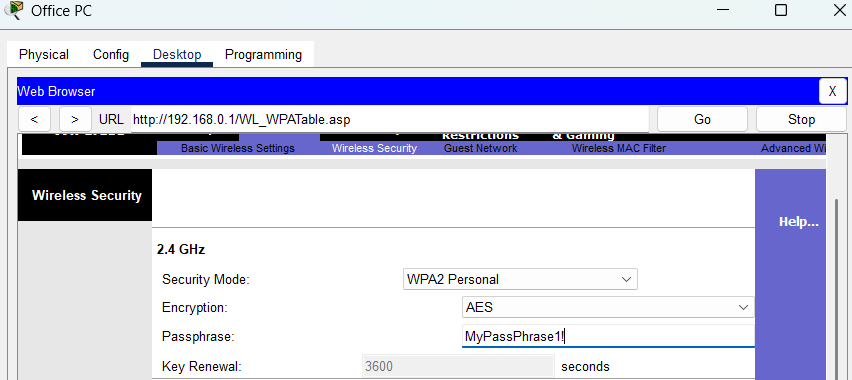

**Security Considerations:**

An unsecured wireless network could expose the network to unauthorised access, misuse of network resources and interception of unprotected communications.

Although WPA2-Personal is suitable for many home networks, its reliance on a shared passphrase limits individual access management and accountability.

In an enterprise environment, WPA2-Enterprise or WPA3-Enterprise with 802.1X authentication can provide individual authentication and more granular access management.

### Part 3: Client Device Configuration and Connectivity

#### Step 1: Connecting the Wireless Laptop

The laptop was configured to connect to the secured wireless network using the SSID and authentication credentials established during the wireless router configuration.

**Configuration:**

- Opened the laptop in Cisco Packet Tracer.
- Navigated to Desktop > PC Wireless.
- Located the available wireless network with the SSID MyHome.

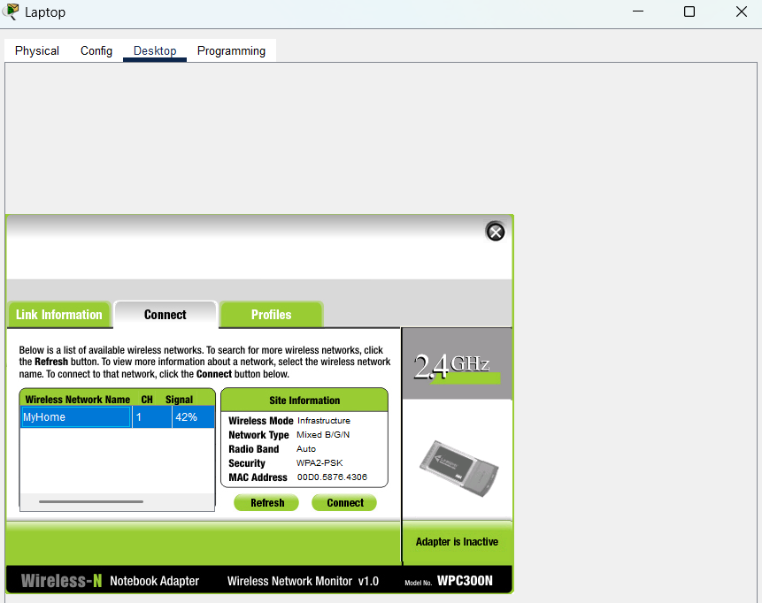

- Selected the wireless network.
- Entered the configured WPA2-Personal pre-shared key.

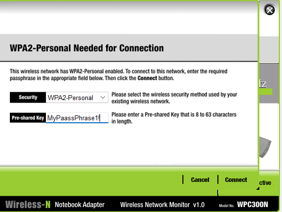

- Established a successful connection to the wireless access point.

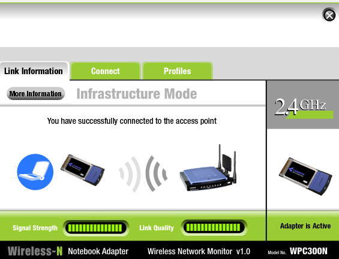

**Purpose:**

This configuration enables the laptop to communicate wirelessly with the local network without requiring a physical Ethernet connection.

**Verification:**

Confirmed that the laptop successfully connected to the wireless access point using the configured security credentials.

**Security Considerations:**

Wireless authentication helps restrict network access to devices possessing the correct credentials. However, shared passphrases do not provide individual user accountability and should be managed securely.

#### Step 2: Verifying Wireless Laptop Connectivity

Following successful wireless authentication, a connectivity test was performed to verify that the laptop could access external network services within the simulated environment.

**Testing Procedure:**

- Opened the laptop in Cisco Packet Tracer.
- Navigated to Desktop > Web Browser.
- Entered Skillsforall.srv into the address bar.
- Confirmed that the simulated webpage loaded successfully.

**Purpose:**

This test verifies that the wireless laptop can communicate with a simulated external web server through the configured network infrastructure.

**Expected Result:**

The simulated webpage should load successfully.

**Actual Result:**

The webpage loaded successfully, confirming connectivity to the simulated web server.

**Test Status:** PASS

**Evidence:**

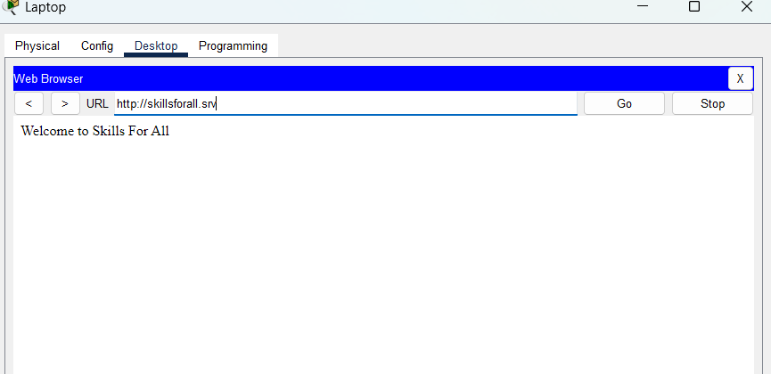

#### Step 3: Verifying Office PC Connectivity

A connectivity test was performed on the Office PC to verify that the wired Ethernet connection and DHCP configuration supported access to external network services within the simulated environment.

**Testing Procedure:**

- Opened the Office PC in Cisco Packet Tracer.
- Navigated to Desktop > Web Browser.
- Entered Skillsforall.srv into the address bar.
- Confirmed that the simulated webpage loaded successfully.

**Purpose:**

This test verifies that the Office PC can communicate with a simulated external web server through its wired network connection.

**Expected Result:**

The simulated webpage should load successfully.

**Actual Result:**

The webpage loaded successfully, confirming connectivity to the simulated web server.

**Test Status:** PASS

**Evidence:**

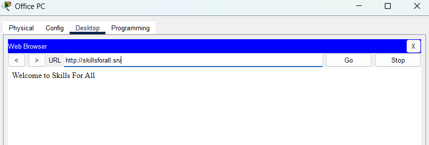

#### Step 4: Configuring the Bedroom PC

The Bedroom PC was configured to obtain its IPv4 network settings automatically through DHCP.

**Configuration:**

- Opened the Bedroom PC in Cisco Packet Tracer.
- Navigated to Desktop > IP Configuration.
- Selected DHCP.
- Confirmed that IPv4 network settings were assigned automatically.

**Purpose:**

Using DHCP allows additional devices to join the network without requiring manual IP address configuration. This simplifies network administration and reduces the risk of configuration errors.

**Evidence:**

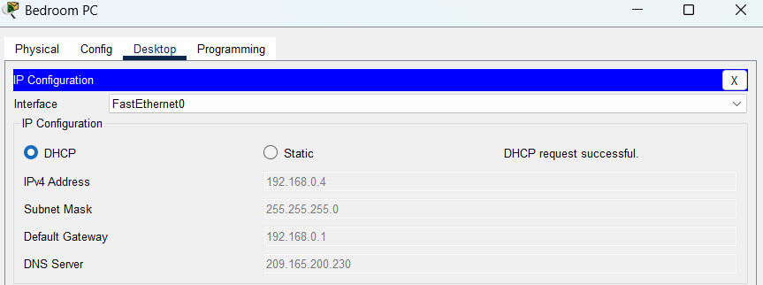

#### Step 5: Verifying Bedroom PC Connectivity

A connectivity test was performed to verify that the Bedroom PC could access external network services through its wired Ethernet connection.

**Testing Procedure:**

- Opened the Bedroom PC in Cisco Packet Tracer.
- Navigated to Desktop > Web Browser.
- Entered Skillsforall.srv into the address bar.
- Confirmed that the simulated webpage loaded successfully.

**Expected Result:**

The simulated webpage should load successfully.

**Actual Result:**

The webpage loaded successfully, confirming connectivity to the simulated web server.

**Test Status:** PASS

**Evidence:**

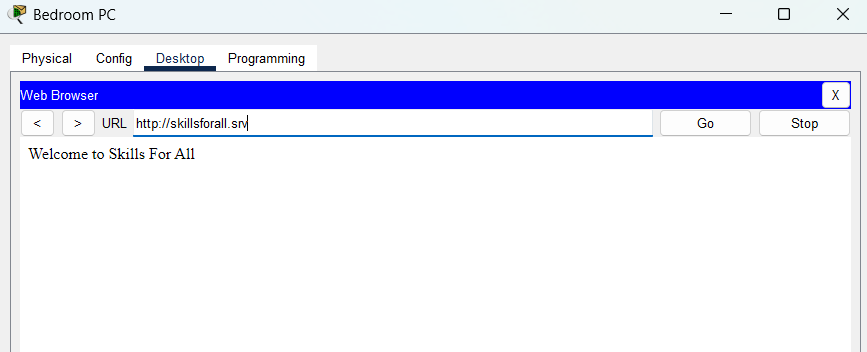

## Security Implementation Summary

Security controls were implemented to reduce the risk of unauthorised access to the simulated home network and its administrative interface.

| Identified Risk | Security Control Implemented | Control Type | Expected Security Benefit |
|---|---|---|---|
| Unauthorised access to router administration | Changed the default administrator password | Preventative | Reduces the risk of unauthorised configuration changes |
| Unauthorised wireless network access | WPA2-Personal authentication | Preventative | Restricts wireless access to devices possessing valid credentials |
| Interception of wireless communications | WPA2 encryption | Preventative | Protects data transmitted over the wireless connection |

### Security Limitations

Although the implemented controls improve the security of the home network, some limitations remain:

- WPA2-Personal relies on a shared passphrase rather than individual user identities.
- Shared credentials limit individual accountability.
- Individual wireless access cannot be easily revoked without changing the shared passphrase.
- Network segmentation and guest network isolation were not implemented.

### Recommended Security Improvements

In a real-world environment, additional security measures could include:

- Regular router firmware updates.
- Strong and unique administrative credentials.
- WPA3 security where supported.
- Guest network isolation.
- Individual authentication using 802.1X in enterprise environments.

These recommendations were identified as potential improvements and were not implemented as part of this simulation.

## Connectivity Testing Summary

Testing was conducted to verify that the network configuration met the project objectives and that connected devices could successfully access simulated network services.

| Test ID | Test Description | Expected Result | Actual Result | Status |
|---|---|---|---|---|
| TC-001 | Office PC DHCP configuration | IPv4 settings assigned automatically | IPv4 settings received | PASS |
| TC-002 | Wireless laptop authentication | Successful connection to MyHome | Connected successfully | PASS |
| TC-003 | Laptop web connectivity | Simulated webpage loads | Webpage loaded successfully | PASS |
| TC-004 | Office PC web connectivity | Simulated webpage loads | Webpage loaded successfully | PASS |
| TC-005 | Bedroom PC DHCP configuration | IPv4 settings assigned automatically | IPv4 settings received | PASS |
| TC-006 | Bedroom PC web connectivity | Simulated webpage loads | Webpage loaded successfully | PASS |

### Testing Conclusion

All six documented tests passed successfully. The results demonstrate that the configured network supports automatic IPv4 address allocation, wireless authentication and access to a simulated external web server through both wired and wireless connections.

Supporting screenshots are provided throughout the Network Configuration section.

## Practical Troubleshooting Exercise

To extend the original Cisco networking activity, a simulated wireless authentication fault was deliberately introduced to develop practical IT support, troubleshooting and incident management skills.

### Incident Report: INC-001

| Incident Details | Description |
|---|---|
| Incident ID | INC-001 |
| Incident Title | Wireless Authentication Failure |
| Category | Network Connectivity |
| Priority | Medium |
| Affected Device | Wireless Laptop |
| Affected Service | Wireless Network Connectivity |
| Status | Resolved |
| Environment | Cisco Packet Tracer Simulation |

### 1. Problem Identification

The wireless laptop was unable to connect to the MyHome wireless network following a change to the router's WPA2-Personal passphrase.

The laptop was also unable to access the simulated external web server, displaying a "Host Name Unresolved" error.

**Evidence:**

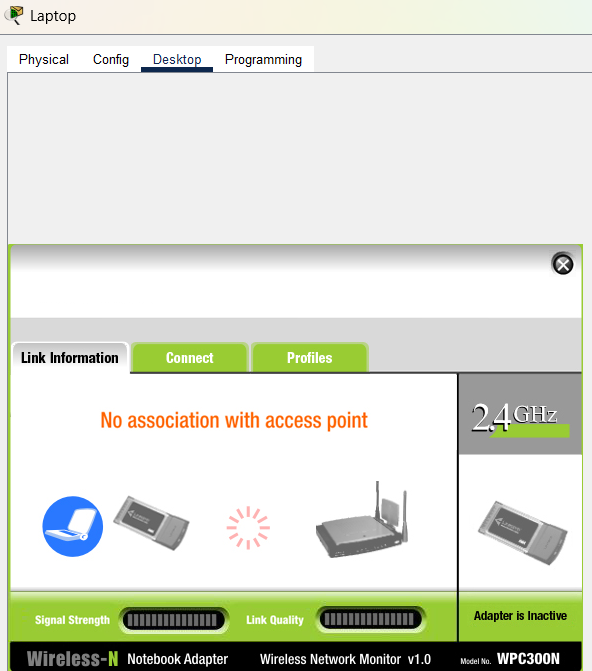

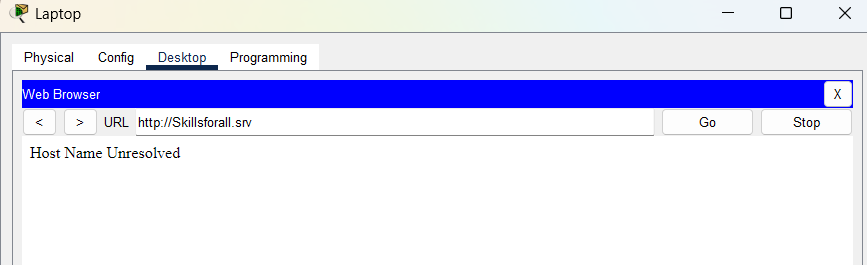

### 2. Investigation and Fault Isolation

The following investigation was conducted:

- Confirmed that the laptop had working connectivity before the configuration change.
- Checked the laptop's wireless connection status.
- Attempted to access the simulated external web server.
- Tested web connectivity from the wired Office PC.
- Confirmed that the Office PC could still access the simulated webpage.

The successful Office PC connectivity test indicated that the issue was not a network-wide outage.

**Evidence:**

### 3. Root Cause Analysis

The root cause was identified as a wireless authentication mismatch.

The router's WPA2-Personal passphrase had been changed, while the laptop retained its original wireless credentials.

Although the browser displayed a hostname resolution error, the underlying issue was the loss of wireless connectivity rather than an independently identified DNS fault.

### 4. Resolution

The following corrective actions were performed:

- Accessed the laptop's wireless interface configuration.
- Confirmed the configured SSID.
- Updated the laptop's wireless passphrase to match the router's configuration.
- Allowed the laptop to reconnect to the wireless network.

The existing WPA2-Personal security configuration was maintained throughout the resolution.

No changes to the router's DHCP or DNS settings were required.

### 5. Resolution Verification

Following the corrective action, the laptop successfully reconnected to the MyHome wireless network.

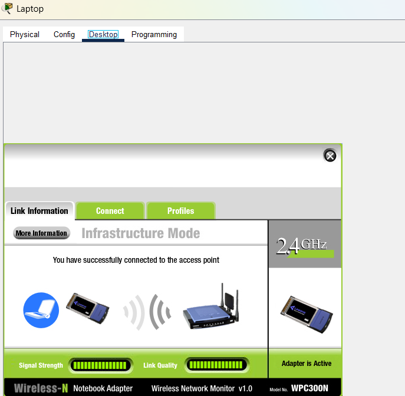

Web connectivity was tested again by accessing Skillsforall.srv.

The simulated webpage loaded successfully, confirming that connectivity had been restored.

### 6. Incident Testing Results

| Test ID | Test Description | Before Resolution | After Resolution |
|---|---|---|---|
| INC-TC-001 | Laptop wireless connection | FAIL | PASS |
| INC-TC-002 | Laptop web connectivity | FAIL | PASS |
| INC-TC-003 | Office PC web connectivity | PASS | Not retested |

**Incident Status:** Resolved

### 7. Preventative Recommendations

To reduce the likelihood of similar incidents occurring in a real-world environment:

- Communicate planned wireless credential changes to affected users through approved channels.
- Update authorised devices following credential changes.
- Maintain secure configuration and change management records.
- Verify network connectivity following configuration changes.
- Consider individual authentication in enterprise wireless environments.

### 8. Lessons Learned

This troubleshooting exercise demonstrated the importance of:

- Establishing a working network baseline.
- Identifying symptoms before implementing a solution.
- Using fault isolation to narrow down probable causes.
- Distinguishing error messages from underlying root causes.
- Maintaining security controls during troubleshooting.
- Verifying functionality following corrective action.
- Documenting technical incidents and supporting evidence.

## Project Learning Outcomes

Through completing this project, I developed practical knowledge and skills in the following areas:

### Networking

- Understanding the relationship between LAN and WAN connections.
- Configuring wired and wireless network devices.
- Understanding IPv4 addressing, subnet masks and default gateways.
- Configuring automatic IP address allocation using DHCP.
- Verifying network connectivity and functionality.

### Cybersecurity and Access Control

- Recognising security risks associated with default administrative credentials.
- Implementing basic router hardening measures.
- Understanding wireless authentication and encryption.
- Identifying the limitations of shared credentials.
- Recognising the benefits of individual authentication in enterprise environments.

### IT Support and Troubleshooting

- Establishing a working network baseline.
- Investigating network connectivity issues.
- Applying fault isolation and root cause analysis.
- Resolving wireless authentication failures.
- Verifying system functionality following corrective action.
- Producing structured incident reports and technical documentation.

### Governance and Risk Awareness

- Identifying security risks and appropriate preventative controls.
- Recognising the limitations of implemented security controls.
- Collecting evidence to support testing and verification.
- Recommending preventative measures to reduce future risks.

## Future Development

To build upon the skills developed through this project, I intend to explore:

- Network segmentation using VLANs.
- Small business network design.
- Access control lists (ACLs).
- Enterprise wireless authentication using 802.1X.
- Identity and access management.
- Security risk assessments and control evaluation.

These areas represent future learning objectives and were not implemented as part of this project.

## Project Conclusion

This project successfully demonstrated the configuration, security and connectivity testing of a simulated home network.

The additional troubleshooting exercise extended the original networking activity by introducing a wireless authentication fault, investigating its root cause and implementing a successful resolution.

The project provides practical evidence of my developing skills in networking, IT support, cybersecurity and security risk awareness.

## Acknowledgements

The initial network configuration was based on the Cisco Networking Basics activity "Configure a Wireless Router and Clients".

The project was extended through additional security analysis, structured connectivity testing documentation, a simulated troubleshooting exercise and an incident report to support my professional development.

